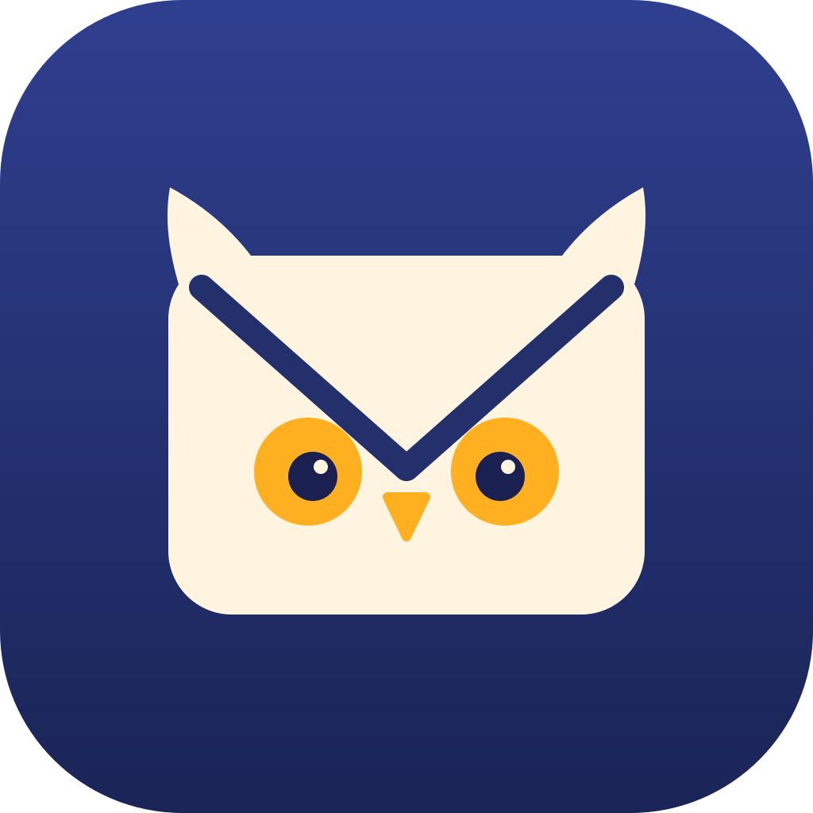

<p align="center">
  
</p>

<h1 align="center">MailOwl</h1>

<p align="center">跑在你自己 Mac 上的私人邮件秘书：替你盯着多个邮箱、分清轻重，<br>在飞书里帮你查往来、起草回复，<b>你点头才发出</b>；紧急的事让 iPhone 响。</p>

---

## 它做什么

- **任何邮箱**：只要支持 IMAP 或 POP3 就能接，几个邮箱一起管；只读收信，不标已读、不删信。
- **分清轻重**：每封新邮件由模型读一遍，给出级别、一句话摘要、截止时间和要做的事（分级见下表）。
- **在飞书里处理**：回复某张邮件卡片就能针对那封邮件提问（「我之前交过 CV 吗？」），Agent 会翻往来邮件并给出依据。
- **起草回复**：草稿卡片可以按意见改版（「第二段太啰嗦」），落款「熟人 / 正式 / 英文」一键切换，回复卡片时发文件即可加附件。
- **你点头才发出**：Agent 没有发信能力，只能写草稿；点「确认发送」并二次确认后才从原邮箱发出，同一份草稿只会发一次，回信在对方那边归入原邮件的往来。
- **隐私与安全**：邮件全文只存在你的 Mac 上，飞书只收摘要；能读邮件的 Agent 不能上网，需要查网上资料时要你在卡片上同意，再交给一个读不到邮箱的研究 Agent。
- **模型可换**：默认用本机已登录的 Claude Code；也可以接任何 OpenAI 兼容接口（DeepSeek、通义千问、Kimi、GPT、Grok、OpenRouter、本地 Ollama）。

| 级别 | 例子 | 通知方式 |
|---|---|---|
| 0 广告 / 订阅 | 电商、账单、期刊推送 | 只进每天早晚的摘要 |
| 1 值得一读 | 组会通知、公告 | 进摘要 |
| 2 需要处理 | 要你回复、交材料 | 即时飞书卡片 + iPhone 提醒，自动建待办 |
| 3 紧急 | 48 小时内截止 | 即时卡片 + 时效性提醒（专注模式下也响），20 分钟没处理再次响铃 |

```
邮箱（IMAP/POP3，只读）──每 3 分钟──▶ 你的 Mac（后台服务，SQLite 本地存储）
                                          │
                                模型分级：级别 / 摘要 / 截止 / 待办
                                          │
          ┌───────────────────────────────┼──────────────────────────┐
          ▼                               ▼                          ▼
   0/1 级：早晚摘要              2 级：飞书卡片 + Bark        3 级：卡片 + 响铃升级
                                          │
             飞书里：提问 → 起草 → 修改 → 换落款 → 确认发送（SMTP，只发一次）
```

飞书机器人走 WebSocket 长连接，**不需要公网 IP、不用开端口**。

## 开始使用

见 [docs/SETUP.md](docs/SETUP.md)：安装 → 邮箱授权码 → 飞书自建应用机器人 → Bark → 启动。

```bash
mailowl check      # 逐项检查邮箱、模型、飞书、Bark
mailowl fetch      # 首次收信：最近 30 天存为历史，不推送
mailowl pair       # 飞书配对码
mailowl run        # 前台运行（正式使用见 deploy/install-launchd.sh）
```

## 现状

以下功能已在真机上验证：收发信、飞书配对与对话、全部卡片按钮、草稿改版与一键换落款、确认发送只发一次、回信线程头、自动待办、Bark 推送与点击跳转、联网研究审批。

还没做或没在真机上验证的：

- OpenAI 兼容后端只跑过模拟测试，还没对真实的 DeepSeek / 千问 / GPT 接口跑过；Tavily 搜索未验证。
- 只支持 macOS（launchd 常驻）；Linux / Docker 还没做。
- 需要邮箱支持用密码或授权码登录 IMAP/SMTP：Outlook / Hotmail 目前接不了（微软只允许 OAuth）；Gmail 用「应用专用密码」，暂不支持 OAuth 登录。
- 界面目前只有飞书（含 Lark 国际版，改 `domain` 即可）。

截图待补。

## 开发

```bash
python3 -m venv .venv && .venv/bin/pip install -e '.[test]'
.venv/bin/python -m pytest -q
```

代码结构：`mailowl/service.py` 主流程，`fetch.py` 收信，`triage.py` 分级，`tools.py` Agent 的邮件工具，`llm.py` / `openai_compat.py` 模型后端，`cards.py` 飞书卡片，`web.py` 研究 Agent 的联网工具。

## English

MailOwl is a self-hosted email assistant that runs on your own Mac. It watches several IMAP/POP3 mailboxes, triages every new message into four levels with an LLM, and talks to you through a Feishu/Lark bot: ask about a thread, get a draft reply, revise it, switch signatures, and send it — only after you tap *Confirm*. The agent has no send tool, each draft can be sent at most once, and the agent that reads your mail cannot browse the web (web research goes through a separate, mailbox-less agent after your approval). Urgent mail rings your iPhone via Bark. Works with the local Claude Code CLI or any OpenAI-compatible API. The UI and docs are currently in Chinese.

## License

[MIT](LICENSE)
