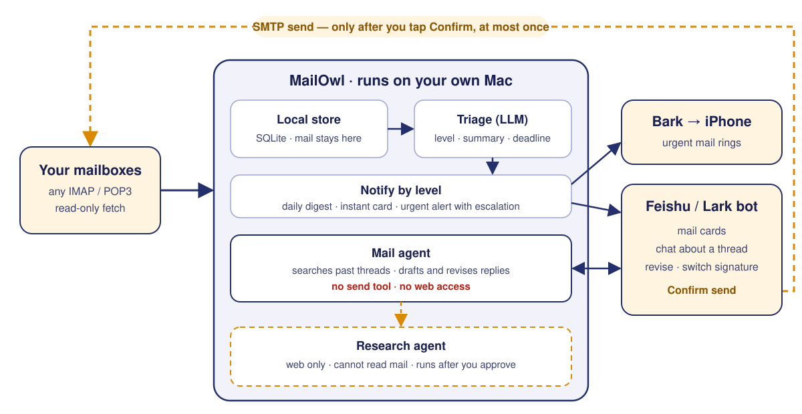
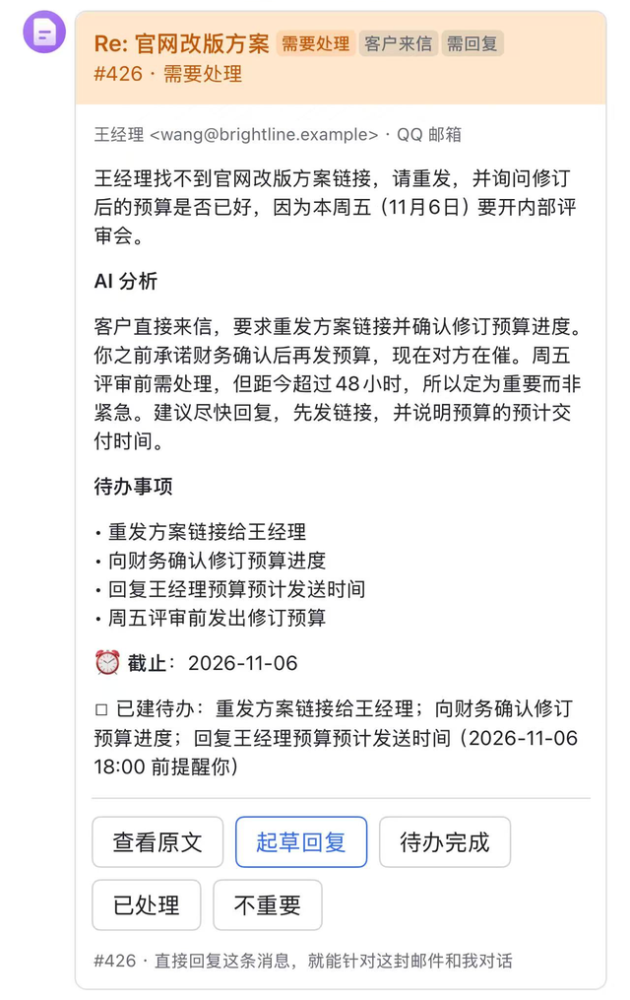
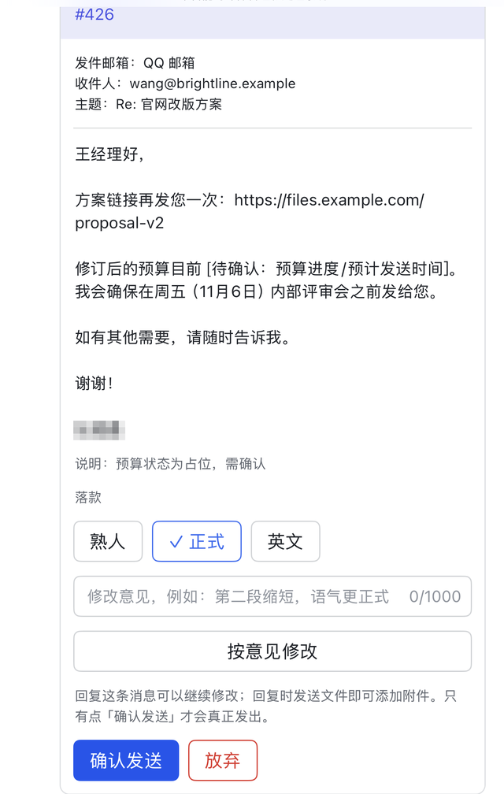
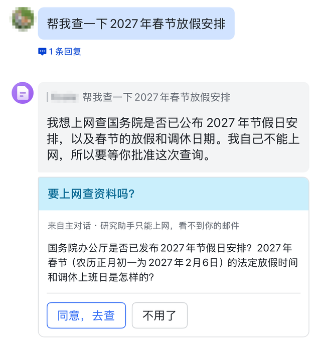
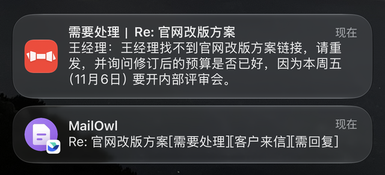

<p align="center">
  
</p>

<h1 align="center">MailOwl</h1>

<p align="center">
  <b>A local-first AI email secretary that drafts in your voice and never sends without your say-so.</b><br>
  Watches every inbox on your Mac, filters out the noise, and brings actionable threads to your chat app — where replies wait for your explicit <i>Confirm</i>.
</p>

<p align="center">
  <a href="https://github.com/YaoxinBio/mailowl/actions/workflows/ci.yml"></a>
  <a href="LICENSE"></a>
  
  
</p>

<p align="center"><b>English</b> · <a href="README.zh-CN.md">简体中文</a></p>


<p align="center">
  <br>
  <sub><code>mailowl demo</code> — real output on fictional mail: triage, a reply drafted from past correspondence, and a prompt-injection email that gets nowhere.</sub>
</p>

---

## Why MailOwl

Giving an AI access to your email usually forces an ugly trade-off: hand your entire inbox to a third-party cloud just to get shallow summaries, or give an autonomous agent SMTP access and pray it doesn't hallucinate a commitment or fall for a prompt injection.

MailOwl takes a different approach:

- **Runs on your Mac, stays on your Mac** — Every message lives in a local SQLite database. Your inbox is never synced to a vendor's cloud; only the message being triaged or answered is sent to the model you choose.
- **Goes beyond summaries** — Before drafting a reply, MailOwl searches your past correspondence with that contact, matches the thread's language, and applies your signature templates so the draft actually reads like you wrote it.
- **Capability-isolated by architecture** — The agent that reads your mail **has no send tool and no web access**. It cannot send an email, and it cannot open a web page to smuggle your data out. Outbound mail happens strictly outside the agent loop, only when you tap *Confirm*, and at most once per draft.

## How It Works

<p align="center">
  
</p>

1. **Fetch** — Polls your mailboxes every few minutes over read-only IMAP/POP3. It never marks messages as read and never deletes anything on the server.
2. **Triage** — An LLM evaluates each new arrival and extracts a priority level (`0`–`3`), a one-line summary, any deadline, and concrete action items.
3. **Notify** — Routes each message by urgency: batches low-priority mail into a twice-daily digest, pushes an interactive card to your chat app, or fires an urgent phone alert that re-rings if ignored.
4. **Act** — Reply directly to a chat card to query your inbox history, generate or revise a draft, swap signatures with one tap, attach files, and confirm to send.

| Level | Typical mail | What happens |
|---|---|---|
| **0 · Notification** | Newsletters, receipts, promotions | Batched into morning / evening digest only |
| **1 · Worth reading** | Announcements, meeting notices | Included in digest |
| **2 · Needs action** | A reply or document is expected | Instant chat card + phone alert; todo created automatically |
| **3 · Urgent** | Deadline within 48 hours | Instant chat card + time-sensitive phone alert; rings again after 20 min if unhandled |

## In your chat app

| A new mail, triaged | A draft with one-tap signatures | Web research needs your approval |
|:---:|:---:|:---:|
|  |  |  |

<p align="center">
  <br>
  <sub>Important mail also reaches your lock screen via Bark. Fictional mail; the chat UI is currently in Chinese.</sub>
</p>

## Features

- **Any IMAP/POP3 mailbox** — Connect any mailbox that supports IMAP or POP3 with an app password, and manage multiple accounts side by side.
- **Talk to your inbox history** — Reply to a thread card with questions like *"Did I already send them my CV?"* The agent searches your sent mail and cites the exact messages in its answer.
- **Drafts that sound like you** — Replies automatically match the thread's language, draw on your past emails with the same recipient for context and tone, and let you switch signature templates (*casual*, *formal*, *English*) with a single tap.
- **Automatic todos & follow-ups** — Action items with deadlines become tracked todos automatically, trigger reminders before they come due, and close themselves as soon as your reply goes out.
- **Fast** — a lightweight check every 20 s on a kept-open connection notices new mail within about 20 seconds on most servers (QQ Mail caches for up to a minute); a full sync every 3 minutes is the safety net. If the model fails, the mail is pushed to you right away instead of waiting for the digest.
- **Quiet by default** — Non-urgent notifications stay silent overnight, burst arrivals are coalesced into a single alert, and hourly notifications are hard-capped.
- **Bring your own model** — Run against the local Claude Code CLI already logged in on your Mac, or point MailOwl at any OpenAI-compatible API.
- **Zero open ports** — The chat bot connects via an outbound WebSocket, so your Mac requires no public IP, port forwarding, or reverse proxy.

## Safety by Design

MailOwl treats incoming email as untrusted input and enforces boundaries in code rather than prompts:

| Threat | Architectural defense |
|---|---|
| **Unapproved or duplicate sending** | The mail-reading agent has no send tool. Sending requires tapping *Confirm* followed by a second confirmation dialog. Each draft is locked to a single send, and ambiguous SMTP outcomes are never retried automatically. |
| **Prompt injection & inbox exfiltration** | The agent that reads mail cannot access the web. Web research is delegated to a separate, inbox-blind agent — and only runs after you approve the exact search question. |
| **Inbox leakage to third-party clouds** | All messages stay in local SQLite. Your chat app receives only the sender, subject, and summary by default (full body is sent only when you ask). You can also block specific senders or keywords from ever reaching the model. |
| **Unauthorized chat access** | The bot binds to a single user account via a one-time pairing code and refuses everyone else. |

## Privacy mode

Every item below is optional — mix and match.

| What leaves your Mac | Default | Most private setting |
|---|---|---|
| Mail text sent to a model | every new message (for triage) and the ones you chat about | `[llm.triage]` pointing at a local Ollama model: triage never sends mail to a model vendor. Point the main backend at a local model too and nothing does. |
| Chat app (Feishu / Lark) | sender, subject and summary; the body only on request | `body_in_feishu = "never"` |
| Phone alerts (Bark) | subject and summary | `[bark] content = "minimal"` — alerts say only that something needs attention |
| Web research | only the questions you approve | `research_backend = "none"` |

Triage is a short, tool-free classification task, which suits small local models; drafting is multi-step tool use and benefits from a larger model. Local inference has been tested with a 27B Qwen model; smaller models have not been benchmarked yet.

## Quick Start

**Try it in 30 seconds — no mailbox, no chat bot needed.** `mailowl demo` triages four fictional emails, drafts a reply from past correspondence, and shows a prompt-injection email failing to make the agent send anything:

```bash
uv tool install git+https://github.com/YaoxinBio/mailowl
mailowl demo                                                    # uses your Claude Code login
mailowl demo --base-url http://127.0.0.1:11434/v1 --model qwen3  # or a local Ollama model
```

Then connect your own mailboxes:

```bash
uv tool install git+https://github.com/YaoxinBio/mailowl   # or: pipx install git+https://github.com/YaoxinBio/mailowl
mailowl init              # config templates in ~/.config/mailowl/
mailowl check             # verify mailboxes, model, chat bot, Bark
mailowl fetch             # first fetch: last 30 days stored as history, no alerts
mailowl service install   # run in the background (starts at login, restarts on crash)
```

For step-by-step configuration (mailbox app passwords, Feishu/Lark bot setup, and Bark push alerts), see **[docs/SETUP.en.md](docs/SETUP.en.md)**.

## Models

| Backend | Configure | Notes |
|---|---|---|
| **Claude Code CLI** (default) | `backend = "claude_cli"` | Reuses the Claude Code CLI session already logged in on the host |
| **OpenAI-compatible** | `backend = "openai"`, `base_url`, `api_key` | DeepSeek, Qwen, Kimi, OpenAI, Grok, OpenRouter, etc. (requires function calling) |
| **Local model (Ollama, LM Studio …)** | `backend = "openai"`, `base_url = "http://127.0.0.1:11434/v1"` | mail text never leaves your Mac for inference; tested with a 27B Qwen model |

## Status

MailOwl is in an early stage. The core workflow is **verified end-to-end on real devices**:

- Fetching and sending across multiple mailboxes
- Feishu pairing, interactive chat, and every card action
- Draft revisions, one-tap signature switching, and proper reply threading headers
- Strictly-once sending enforcement
- Automatic todo creation, Bark push alerts with tap-to-open, and the gated web-research approval flow

**Not yet implemented or verified:**

- The OpenAI-compatible backend is verified with a local Ollama model; hosted APIs (DeepSeek, OpenAI, …) have not been tested live yet, and web search via Tavily is unverified.
- macOS only (`launchd`); no Linux or Docker packaging yet.
- Mailboxes must support app-password login: Outlook/Hotmail (OAuth-only) are not supported directly — auto-forward them to a supported mailbox as a workaround (see the setup guide). Gmail works via app password, with no OAuth support yet.
- The chat interface is Feishu/Lark only, and Lark (international) has not been tested.
- Model output (summaries, answers) follows `language = "en"` or `"zh"`, but chat-card labels and buttons are still in Chinese.

## Roadmap

- [ ] Local web console — setup wizard, mailbox status, and settings; later wrapped as a macOS menu-bar app
- [ ] Telegram as a second chat interface
- [ ] Linux / Docker support
- [ ] Gmail OAuth login
- [ ] English UI and prompts
- [ ] PyPI release

## Contributing

Issues and pull requests are welcome — see [CONTRIBUTING.md](CONTRIBUTING.md). Please report security vulnerabilities privately as described in [SECURITY.md](SECURITY.md).

## License

[MIT](LICENSE)
