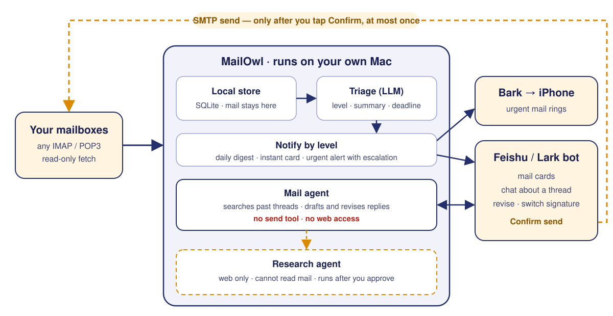

<p align="center">
  
</p>

<h1 align="center">MailOwl</h1>

<p align="center">
  <b>跑在你自己 Mac 上的 AI 邮件秘书：用你的语气替你起草，不经你点头绝不发信。</b><br>
  替你盯着所有邮箱、筛掉噪音，把真正要处理的事推到聊天软件里——只有你点下「确认发送」，信才会发出。
</p>

<p align="center">
  <a href="https://github.com/YaoxinBio/mailowl/actions/workflows/ci.yml"></a>
  <a href="LICENSE"></a>
  
  
</p>

<p align="center"><a href="README.md">English</a> · <b>简体中文</b></p>

---

## 为什么做 MailOwl

把邮箱交给 AI，通常会面临两难：要么把所有私人邮件上传到别人的云端，换来几句不痛不痒的摘要；要么给 Agent 开放发信权限，提心吊胆地怕它胡乱承诺，或者被一封恶意邮件提示词注入（Prompt Injection）套走收件箱。

MailOwl 选择了另一条路：

- **数据留在本机** — 跑在你自己的 Mac 上，所有邮件落盘本机 SQLite，不同步到任何第三方云端；只有正在分级或回复的那封邮件会发给你选的模型。
- **不止于摘要，替你把信写好** — 起草回复前先翻出你和对方过去的往来邮件，自动跟随原信语言、套用你的落款模板，写出真正像你手笔的草稿。
- **架构级权限隔离** — 能读邮件的 Agent **既没有发信工具，也不能联网**，从结构上堵死擅自发信、借网页外泄邮件这两条路。发信动作完全脱离模型回路，必须由你手动二次确认，且同一份草稿最多只能发出一次。

## 工作方式

<p align="center">
  
</p>

1. **收信** — 每隔几分钟通过 IMAP/POP3 只读拉取新邮件，不改已读状态、不删服务端邮件。
2. **分级** — 模型阅读每封新邮件，提取优先级（`0`–`3`）、一句话摘要、截止时间和待办事项。
3. **通知** — 按轻重缓急分流：低优邮件归入早晚摘要，重要邮件即时推送聊天卡片，紧急邮件触发手机强提醒（超时未处理会再次响铃）。
4. **处理** — 直接回复卡片即可追问历史往来、生成或修改草稿、一键切换落款、添加附件，最后点击确认发出。

| 级别 | 典型邮件 | 处理方式 |
|---|---|---|
| **0 · 通知** | 订阅周刊、账单回执、营销推广 | 仅汇总进早晚摘要，平时零打扰 |
| **1 · 值得一读** | 内部公告、普通会议通知 | 汇总进每日摘要 |
| **2 · 需要处理** | 需要你回复、拍板或提交材料 | 即时推送聊天卡片 + 手机提醒，自动创建待办 |
| **3 · 紧急** | 48 小时内截止的事项 | 即时卡片 + 时效性手机强提醒，20 分钟未处理再次响铃 |

## 功能

- **通吃主流协议邮箱** — 只要支持 IMAP 或 POP3 且能用授权码登录即可接入，多个邮箱统一托管。
- **拿着邮件直接追问** — 回复卡片问一句「我之前给他们发过 CV 吗？」，Agent 会检索已发送邮件，并在回答中附上对应邮件编号作为依据。
- **写得像你本人** — 回复自动匹配来信语种，参考你与同一收件人的历史往来拿捏分寸；落款支持「熟人」「正式」「英文」等多套模板一键切换。
- **待办闭环管理** — 带截止时间的事项自动转为待办，到期前主动提醒，回信发出后自动标记完成。
- **默认克制不打扰** — 夜间自动静音非紧急邮件，短时间内多条提醒自动合并，并严格限制每小时推送上限。
- **模型自选** — 默认直接调用本机已登录的 Claude Code，也可接入任何支持工具调用的 OpenAI 兼容接口。
- **无需公网 IP** — 聊天机器人通过主动连出的 WebSocket 长连接通信，无需内网穿透或配置反向代理。

## 安全设计

MailOwl 默认把所有外来邮件视为不可信输入，用代码边界而非提示词约束来保障安全：

| 风险场景 | MailOwl 的架构防线 |
|---|---|
| **AI 擅自发信或重复发信** | 读信 Agent 没有发信工具。发信必须点击卡片上的「确认发送」并通过二次确认弹窗；同一份草稿严格限制只发一次；遇到 SMTP 结果不确定时绝不自动重试。 |
| **恶意邮件诱导 AI 泄露收件箱** | 读写分离、网络隔离：能读邮件的 Agent 完全断网；联网查资料由另一个读不到邮件的独立 Agent 执行，且每次搜索前必须经你批准具体问题。 |
| **隐私邮件流向第三方云端** | 邮件全量保存在本机 SQLite。聊天软件默认只接收发件人、主题和摘要，仅在你主动查看时才推送正文。支持按发件人或关键词配置黑名单，完全绕过模型处理。 |
| **陌生人盗用你的机器人** | 机器人首次启动通过一次性配对码与唯一账号绑定，其他任何账号发来的消息一律拒绝。 |

## 快速开始

```bash
git clone https://github.com/YaoxinBio/mailowl.git && cd mailowl
python3 -m venv .venv && .venv/bin/pip install -e .
.venv/bin/mailowl init     # 在 ~/.config/mailowl/ 生成配置模板
.venv/bin/mailowl check    # 检查邮箱、模型、聊天机器人、Bark
.venv/bin/mailowl fetch    # 首次收信：最近 30 天存为历史，不推送
bash deploy/install-launchd.sh
```

完整配置步骤（邮箱授权码、飞书机器人、Bark 推送）：**[docs/SETUP.md](docs/SETUP.md)**。

## 模型

| 后端 | 配置 | 说明 |
|---|---|---|
| **Claude Code CLI**（默认） | `backend = "claude_cli"` | 直接复用宿主机上已登录的 Claude Code CLI |
| **OpenAI 兼容接口** | `backend = "openai"`、`base_url`、`api_key` | 支持 DeepSeek、通义千问、Kimi、OpenAI、Grok、OpenRouter、Ollama 等（模型需支持工具调用） |

## 现状

项目处于早期阶段。以下核心链路**已在真机上完成端到端验证**：

- 多个邮箱的收信与发信
- 飞书配对绑定、多轮对话及全部卡片交互按钮
- 草稿多轮改版、一键切换落款、完整的回信线程头（Thread Headers）
- 单次发送锁（防止重复发信）
- 自动待办闭环、Bark 强提醒与点击跳转、联网研究审批流

**尚未完成或待验证：**

- OpenAI 兼容后端目前仅跑过模拟测试（Mock Tests）；基于 Tavily 的网页搜索尚未真机验证。
- 目前仅支持 macOS（依赖 `launchd`），暂未提供 Linux / Docker 部署方案。
- 邮箱需支持授权码登录：暂不支持仅允许 OAuth 的 Outlook / Hotmail；Gmail 需配合应用专用密码使用，暂不支持 OAuth。
- 聊天端目前仅支持飞书，Lark 国际版尚未测试。
- 界面文案与内置提示词目前均为中文。

## 路线图

- [ ] 本地网页控制台：配置向导、邮箱状态监控、参数设置；后续打包为 macOS 菜单栏应用
- [ ] 支持 Telegram 作为第二个聊天端
- [ ] Linux / Docker 部署支持
- [ ] Gmail OAuth 登录
- [ ] 英文界面与提示词
- [ ] 发布至 PyPI

## 参与贡献

欢迎提交 Issue 和 Pull Request，详见 [CONTRIBUTING.md](CONTRIBUTING.md)。如发现安全问题，请按 [SECURITY.md](SECURITY.md) 中的说明私下报告。

## 许可证

[MIT](LICENSE)
